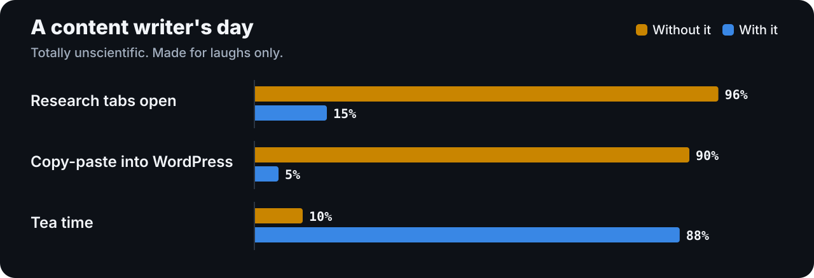

<p align="center"><b>English</b> · <a href="README.ar.md">العربية</a></p>

<p align="center"></p>

> **From a topic to a published post.** Takes a topic, researches it, writes the post through `seo-blog-write-ar-en`, prepares images and categories, and publishes to WordPress through the REST API. RankMath and Schema values are handed to you ready to paste.

## How it works

<p align="center"></p>

## Just say it

- "Publish a blog post about this topic on my site"
- "Write a post and upload it to the site"

## The results (joking, but also not really)

<p align="center"></p>

## Install in a minute

| You use | How to install |
|---|---|
| A Claude or ChatGPT account | Download [`wordpress-seo-blog-publisher.zip`](https://github.com/Marsadgrouplabs/wordpress-seo-blog-publisher/releases/latest/download/wordpress-seo-blog-publisher.zip) and upload it under Skills |
| Claude Code | `claude plugin marketplace add Marsadgrouplabs/wordpress-seo-blog-publisher` |
| Claude Code or Codex with a script | Clone the repo and run `install.ps1` or `install.sh` |

<details>
<summary><b>Step-by-step instructions</b></summary>

### Claude or ChatGPT account

1. Download [`wordpress-seo-blog-publisher.zip`](https://github.com/Marsadgrouplabs/wordpress-seo-blog-publisher/releases/latest/download/wordpress-seo-blog-publisher.zip) and keep it zipped.
2. **Claude:** open Skills in your account and choose to upload a file.
3. **ChatGPT:** open Skills, then Create, then Upload from your computer. Availability depends on your plan.

### Claude Code plugin

```bash
claude plugin marketplace add Marsadgrouplabs/wordpress-seo-blog-publisher
claude plugin install wordpress-seo-blog-publisher@marsad-wordpress-seo-blog-publisher
```

### Windows

```powershell
git clone https://github.com/Marsadgrouplabs/wordpress-seo-blog-publisher.git
cd wordpress-seo-blog-publisher
powershell -ExecutionPolicy Bypass -File .\install.ps1
```

### macOS or Linux

```bash
git clone https://github.com/Marsadgrouplabs/wordpress-seo-blog-publisher.git
cd wordpress-seo-blog-publisher
bash install.sh
```

The script installs to `~/.claude/skills` for Claude Code and `~/.agents/skills` for Codex, and keeps a backup of any older copy.

</details>

## Who publishes this, and where does your data go?

Published by **[Marsad Labs](https://labs.marsadgroup.co)**. Marsad Labs is the product arm of Marsad Group, a UK-registered marketing agency, and builds practical tools for marketers and developers. [About us](https://labs.marsadgroup.co/about-us/) · [Privacy policy](https://labs.marsadgroup.co/privacy-policy/)

| Question | Answer |
|---|---|
| **Login details** | They stay in a `sites.txt` file on your computer. They are never uploaded with the skill or printed. |
| **What does it connect to?** | The `wp.py` script connects only to the WordPress sites you list in that file. |
| **Does it publish on its own?** | Yes, when you ask it to publish a post: it creates a Draft first and then publishes it. Use an Application Password with suitable permissions. |
| **Code** | One script built on the Python standard library, open for you to read. |

This version was scanned with SkillSpector, its critical and high alerts were reviewed by hand, and client data and keys were removed. The full result, how to verify the file and how to report a problem are in [`SECURITY.md`](SECURITY.md).

## What you need

- Python 3.
- A WordPress site with RankMath, and an Application Password for a user who can publish.
- The `seo-blog-write-ar-en` skill installed alongside it.

## Before you start

- **One-time site setup:** copy `scripts/sites.example.txt` to `~/.wp-publisher/sites.txt` and add your site details. That file stays on your computer and is never uploaded.
- **Actual publishing** needs Claude Code or Codex on your computer, because the login details live there.

## Rights

All rights reserved by Marsad Labs. Copying or redistribution without permission is not allowed.

---

<p align="center">Made with love and far too much tea at <a href="https://labs.marsadgroup.co"><b>Marsad Labs</b></a></p>
